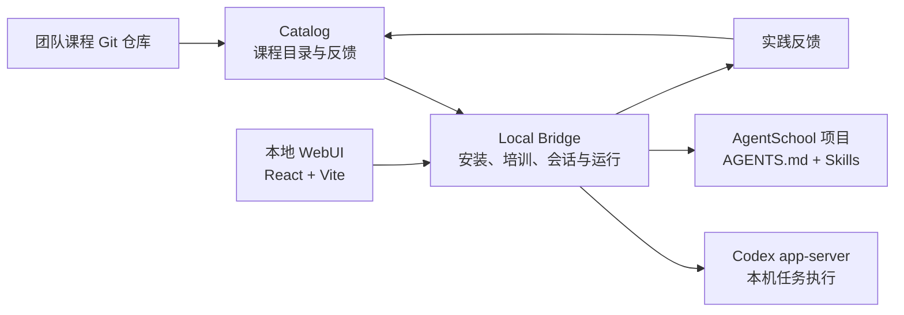

<div align="center">

# Agent School

**把团队的角色经验与 Skills，培训成本地可用的 AI 员工。**

一个本机运行的职业角色学习中心：发现角色、装载能力、测试调试、持续协作，并把实践反馈带回团队课程。

[](https://nodejs.org/)
[](https://pnpm.io/)
[](https://react.dev/)
[](https://www.typescriptlang.org/)
[](https://github.com/openai/codex)

</div>

## 项目简介

Agent School 不只是一个 Skill Hub。团队可以把某一类职业角色沉淀为 Agent，将**角色设定、工作指令和 Skills**组合成可培训、可验证、可持续使用的本地员工。

员工通过本地 WebUI 完成整个流程，任务执行、文件操作和 Skill 安装均发生在自己的电脑上。课程维护人继续使用熟悉的 Git 工作流发布和改进内容。

```text
发现角色 → 培训到本地项目 → 测试与调试 → 成为我的员工 → 反馈与更新
```

## 核心能力

- **角色培训中心**：集中展示 Agent 的角色说明、指令和能力配置。
- **项目化培训**：在独立工作目录生成 `AGENTS.md`，并安装该角色需要的 Skills，不污染全局环境。
- **自动化测试**：通过本机 `codex app-server` 在指定项目中执行测试任务，展示过程、审批、结果和生成文件。
- **员工式协作**：培训完成后进入「我的员工」，每个员工保留一条持续会话。
- **统一交互界面**：使用 shadcn/ui（Base UI）与官方 AI Elements Patterns，保留员工列表、聊天和配置三栏布局，展示流式回复、工具状态和终端输出。
- **按轮调用能力**：输入 `@` 插入高亮 Skill 标签，并为每轮配置模型、思考强度和权限。
- **多模态输入**：支持文字、图片和普通文件，便于使用真实材料验证员工能力。
- **团队课程闭环**：记录问题、评价和改进建议，维护人通过 Git 发布新版本。
- **本机 Codex 管理**：查看运行状态并管理本地 Codex 配置。

## 快速开始

### 环境要求

- Node.js **22.13 或更高版本**
- pnpm **10.9**
- Git
- 已安装并登录的 Codex CLI **0.163.0**

### 运行演示环境

```bash
git clone git@github.com:leonzone/agent-school.git
cd agent-school
pnpm install

# 创建本地演示课程仓库，不会覆盖已有课程
pnpm demo:init

pnpm build
pnpm start
```

打开 **http://127.0.0.1:43111**，即可进入 Agent School。

`pnpm demo:init` 会根据 `examples/course-template` 创建演示课程及本地 Git remote，适合第一次体验完整流程。

### 开发模式

```bash
pnpm demo:init
pnpm dev
```

开发页面位于 **http://127.0.0.1:5173**，API 请求会代理到本机 Bridge。

### 使用团队课程仓库

```bash
SKILLHUB_COURSE_URL=git@github.com:your-org/agent-courses.git \
SKILLHUB_COURSE_REF=main \
pnpm start
```

课程仓库可以是本地路径或 Git 仓库地址。维护人更新课程后，员工可在 WebUI 中看到新版本并更新本地培训内容。

## 使用流程

### 1. 在培训中心创建员工

选择一个角色，查看角色设定和 Skills，然后执行「培训」。默认会在本机创建独立项目：

```text
~/AgentSchool/<agent-id>/
├── AGENTS.md
└── .agents/
    └── skills/
        ├── deep-research/
        └── document-writing/
```

### 2. 测试与调试

在员工项目中运行自动化测试，或通过交互式对话自行验证。执行过程支持实时事件、权限审批、停止运行和文件查看。

### 3. 与员工持续协作

培训完成后，员工会出现在「我的员工」中。直接发送任务即可，不需要为同一员工反复创建会话。

在输入框中：

- 输入 `@` 或点击 **Skills**，调用当前员工具备的能力。
- 上传图片、文档、数据或其他测试材料。
- 按本轮任务选择模型、思考强度和权限。
- 点击顶部员工头像，查看角色设定、能力和培训状态。

正文与输入框最大宽度为 800px，并在聊天区域居中。对话超过 20 轮、聊天区域宽度至少 960px 时，左侧留白显示刻度导航：点击跳转到对应轮次，悬停查看问题摘要，当前浏览轮次自动高亮。窄屏隐藏导航。

员工名字与头像支持在右侧原地编辑；用户消息采用黑色气泡，悬停显示发送时间和复制按钮。工具执行记录可展开查看，思考摘要只展示后端实际提供的内容。

### 4. 反馈并更新课程

提交与 Skill 版本关联的问题或建议。维护人在课程 Git 仓库中修改内容、提交并推送，员工随后更新本地版本。

## 系统架构



| 模块 | 职责 | 默认地址或目录 |
| --- | --- | --- |
| `apps/web` | 本地 WebUI | `127.0.0.1:5173`（开发） |
| `apps/bridge` | 本机桥接、培训、会话、Codex 执行 | `127.0.0.1:43111` |
| `apps/catalog` | 课程索引、Skill 包与团队反馈 | `127.0.0.1:43110` |
| `packages/shared` | 前后端共享类型与 Zod Schema | — |
| `packages/codex-protocol` | Codex app-server 协议类型 | — |
| `examples/course-template` | 团队课程仓库模板 | — |

### 常用配置

所有环境变量统一使用 `SKILLHUB_` 前缀。

| 环境变量 | 用途 | 默认值 |
| --- | --- | --- |
| `SKILLHUB_COURSE_URL` | 团队课程 Git 仓库 | `var/demo/remote.git` |
| `SKILLHUB_COURSE_REF` | 课程分支或引用 | `main` |
| `SKILLHUB_AGENTS_ROOT` | 员工项目根目录 | `~/AgentSchool` |
| `SKILLHUB_SKILLS_ROOT` | 独立 Skill 安装目录 | `~/.agents/skills` |
| `SKILLHUB_HOME` | Bridge 数据目录 | `~/.skillhub` |
| `SKILLHUB_CODEX_PATH` | Codex CLI 路径 | `codex` |

## 团队课程结构

每个 Skill 是一个独立目录，至少包含 `SKILL.md`；脚本、模板和参考资料可以一起维护。

```text
course-repository/
└── skills/
    └── deep-research/
        ├── SKILL.md
        ├── skillhub.json
        ├── scripts/
        └── references/
```

`SKILL.md` 示例：

```markdown
---
name: deep-research
description: 将复杂问题拆解为调研任务，形成有证据的研究结论。
---

# 深度调研

在这里编写执行流程、质量要求和输出规范。
```

`skillhub.json` 用于补充展示名称、标签和维护人信息，可直接参考 [`examples/course-template`](examples/course-template)。

## 常用命令

| 命令 | 说明 |
| --- | --- |
| `pnpm demo:init` | 初始化本地演示课程 |
| `pnpm dev` | 启动 Catalog、Bridge 和 Web 开发服务 |
| `pnpm build` | 构建全部工作区 |
| `pnpm typecheck` | 执行全部 TypeScript 类型检查 |
| `pnpm exec tsx --test apps/web/src/chat/timeline.test.ts` | 验证聊天事件合并、失败与中断状态、思考摘要边界 |
| `pnpm start` | 启动生产服务，由 Bridge 托管 Web 构建产物 |
| `pnpm codex:generate` | 从 Codex 重新生成协议类型 |

## 安全与边界

- Catalog 仅监听 loopback 地址。
- Bridge 提供 Host／Origin 白名单和随机会话 Cookie 防护。
- Skill 安装、文件读写和 Codex 执行均发生在本机。
- 默认员工项目位于 `~/AgentSchool`，不会跨设备自动同步。
- 「完全权限」会跳过审批并允许访问工作区外文件，只应在可信、隔离的项目中使用。
- 当前版本仅支持 Codex，不包含云端 Agent 执行、自动学习或复杂课程治理。

## 参与维护

```bash
pnpm typecheck
pnpm build
pnpm exec tsx --test apps/web/src/chat/timeline.test.ts
```

请在提交前完成类型检查和构建验证。不要手动修改 `packages/codex-protocol/src/generated/`，协议类型统一通过 `pnpm codex:generate` 生成。更多项目约定见 [`AGENTS.md`](AGENTS.md)。
